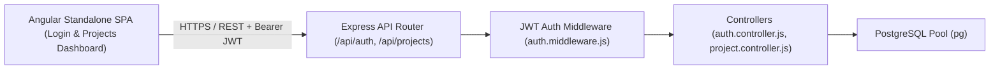

# Project Manager — Full-Stack Planning & Portfolio Tracking Platform

Full-stack web application for project planning, milestone tracking, and portfolio completion analytics engineered with an **Angular** standalone SPA frontend, a **Node.js / Express** REST API backend, **JWT** authentication (`bcryptjs` + `jsonwebtoken`), and **PostgreSQL** (`pg`).

---

## System Architecture



---

## REST API Contract

### Authentication (`/api/auth`)

| Method | Endpoint | Body | Description |
| :--- | :--- | :--- | :--- |
| `POST` | `/api/auth/register` | `{ email, password }` | Validates email format and password length ($\ge 8$), hashes password via `bcryptjs`, creates account (`201` / `409`). |
| `POST` | `/api/auth/login` | `{ email, password }` | Verifies credentials (`401` on mismatch) and issues a signed `JWT` token (`2h` expiration). |

### Projects (`/api/projects` — Requires `Authorization: Bearer <token>`)

| Method | Endpoint | Body / Query | Description |
| :--- | :--- | :--- | :--- |
| `GET` | `/api/projects` | `?status=PLANNED\|IN_PROGRESS\|COMPLETED` | Lists projects owned by the authenticated user with optional status filtering. |
| `GET` | `/api/projects/stats` | — | Returns portfolio telemetry: `total`, `byStatus`, and `averageProgress` (`0-100`). |
| `POST` | `/api/projects` | `{ title, description, status?, priority?, progress?, targetDate? }` | Creates a project entry with validated status (`PLANNED`, `IN_PROGRESS`, `COMPLETED`) and priority (`LOW`, `MEDIUM`, `HIGH`). |
| `PATCH` | `/api/projects/:id` | `{ title?, description?, status?, priority?, progress?, targetDate? }` | Updates project metadata, status transitions, or completion percentage (`0-100`). |
| `DELETE` | `/api/projects/:id` | — | Deletes a project owned by the authenticated user. |

---

## Security Controls

* Environment secrets (`JWT_SECRET`, PostgreSQL credentials) are loaded exclusively from environment variables via `dotenv`; `backend/.env` is excluded by `.gitignore` and documented in [`backend/.env.example`](backend/.env.example).
* Passwords and password hashes are never logged in server output.
* Registration enforces email format checks and minimum 8-character password strength.
* All `/api/projects/*` routes enforce Bearer JWT verification and per-user ownership isolation.

---

## Repository Structure

```text
project-manager/
├── backend/
│   ├── .env.example
│   ├── package.json
│   └── src/
│       ├── app.js
│       ├── index.js
│       ├── config/db.js
│       ├── controllers/
│       │   ├── auth.controller.js
│       │   └── project.controller.js
│       ├── middlewares/auth.middleware.js
│       └── routes/
│           ├── auth.routes.js
│           └── project.routes.js
└── frontend/
    ├── package.json
    └── src/app/
        ├── pages/login/
        ├── pages/projects/
        └── services/auth.ts
```

---

## Local Setup

```bash
# Backend
cd backend
cp .env.example .env
npm install
npm start

# Frontend (new terminal)
cd frontend
npm install
npm start
```

---

## Containerized Deployment (Docker Compose)

Run the full three-tier stack (`Angular / Nginx Unprivileged` -> `Express API` -> `PostgreSQL 16`) with multi-stage builds, non-root users (`UID 101` / `UID 1000`), and automated healthchecks:

```bash
docker compose up --build
```

* **Web UI (Angular 21 + Unprivileged Nginx):** `http://localhost:4200`
* **REST API & Healthcheck (Node 22 Alpine, read-only rootfs):** `http://localhost:3000/health`
* **Database:** PostgreSQL 16 initialized automatically via [`db/init.sql`](db/init.sql)
